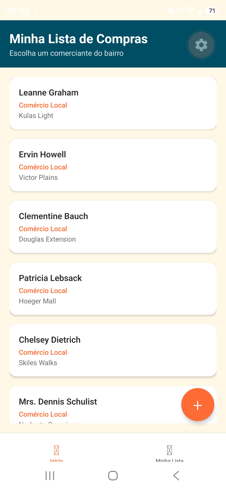
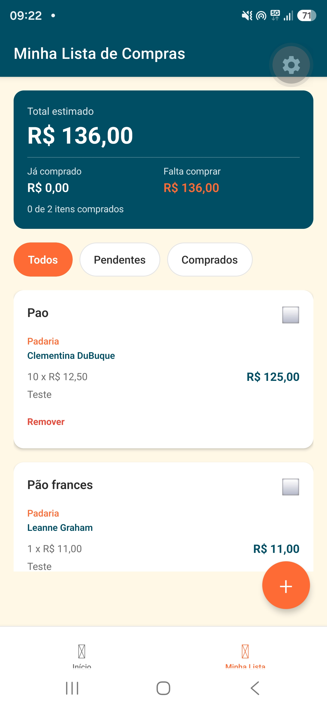
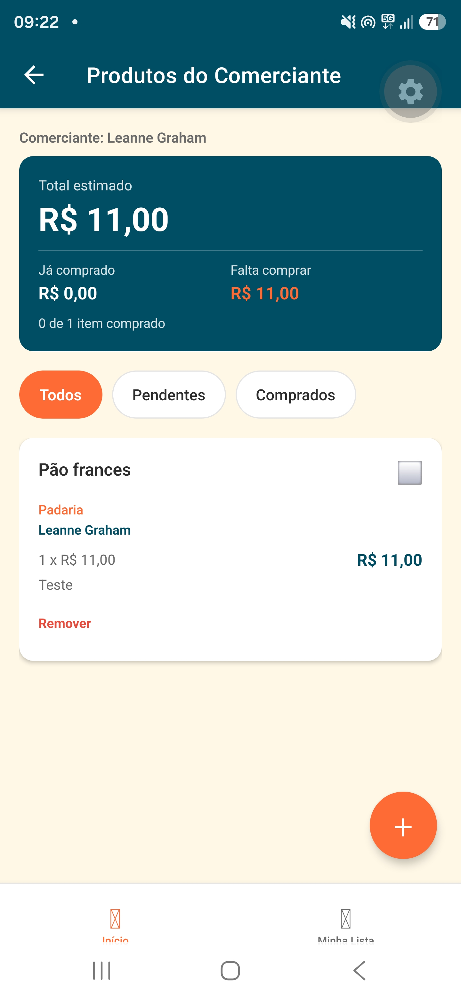
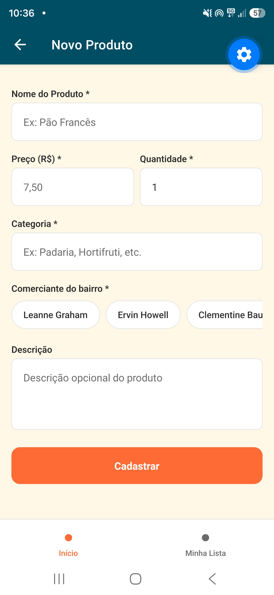
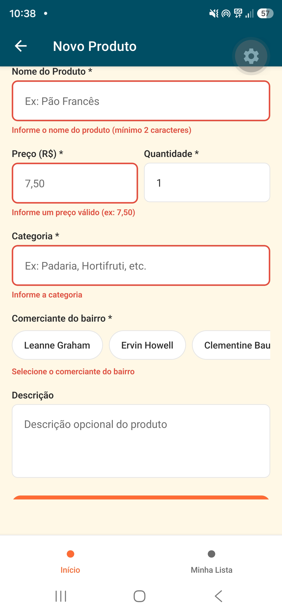

# Vitrine do Bairro - AV2

Aplicativo de Lista de Compras Inteligente para o Desafio Prático Individual (AV2)

## Aluno
- Nome: João Pedro Martins de Paula 
- RA: 1710482421015     

## Sobre o App
Aplicativo mobile desenvolvido em React Native com Expo para organizar as compras
nos comércios locais do bairro.

### Funcionalidades
- Cadastro de produtos com nome, preço, quantidade, categoria e descrição
- Associação de cada produto a um comerciante do bairro
- Marcar produtos como comprados
- Resumo financeiro: total estimado, valor já comprado e o que falta comprar
- Filtro da lista por Todos / Pendentes / Comprados
- Edição e remoção de produtos
- Persistência local dos dados (AsyncStorage) — funciona offline
- Comerciantes carregados de API REST com cache local (offline-first)

## Como Rodar

### Pré-requisitos
- Node.js 22.13 ou superior na linha 22 (ou 24.3+ na linha 24)
- npm
- Expo Go no celular, na versão compatível com o **SDK 58**

### Instalação

```bash
npm install
```

```bash
npx expo start
```

Escaneie o QR Code com o Expo Go (Android/iOS) ou pressione `a` para abrir no
emulador Android e `i` no simulador iOS.

### Verificação de tipagem

```bash
npx tsc --noEmit
```

## Estrutura do Projeto

```
src/
├── components/     # Componentes reutilizáveis (ProductCard, ShoppingSummary, SelectableChip, Header)
├── screens/        # Telas principais (Home, ProductList, ProductForm)
├── services/       # Serviços (API REST, AsyncStorage)
├── hooks/          # Custom hooks (useProducts, useBusinesses)
├── utils/          # Funções puras (formatação pt-BR e regras de domínio)
├── types/          # Interfaces TypeScript e rotas tipadas
├── navigation/     # Configuração de navegação
└── theme/          # Cores e estilos globais
```

### Responsabilidade de cada camada

| Camada | Arquivo | Responsabilidade |
| --- | --- | --- |
| Tipos | `src/types/index.ts` | `Product`, `ProductDraft`, `ProductTotals`, `Business` e rotas tipadas |
| Domínio | `src/utils/products.ts` | criação de produto, subtotal e cálculo dos totais (funções puras) |
| Formatação | `src/utils/format.ts` | moeda pt-BR e leitura de números digitados |
| Persistência | `src/services/storage.ts` | AsyncStorage + validação dos dados lidos |
| API | `src/services/api.ts` | consumo da API REST e mapeamento DTO -> modelo |
| Estado | `src/hooks/useProducts.ts`, `src/hooks/useBusinesses.ts` | estado, loading/error/success e ações |
| UI | `src/screens/`, `src/components/` | telas e componentes reutilizáveis |

## Navegação

Duas abas, cada uma com a própria pilha, e passagem de parâmetros entre telas:

```
Aba Início       Home -> ProductList { businessId, businessName } -> ProductForm { productId? }
Aba Minha Lista  ProductList -> ProductForm { productId? | businessId? }
```

As rotas são tipadas por `RootStackParamList`, e cada tela recebe suas props via
`NativeStackScreenProps`. As safe areas são respeitadas pelo `SafeAreaProvider`,
pelo `SafeAreaView` de cada tela e pelo `paddingBottom` dinâmico da tab bar.

## Estado e formulários

- `useProducts` — concentra a lista de compras: leitura, cadastro, edição, remoção,
  marcação de comprado e totais. Recarrega a lista sempre que a tela ganha foco
  (`useFocusEffect`), para que uma alteração feita no formulário apareça ao voltar.
- `useBusinesses` — carrega os comerciantes com estratégia offline-first.
- O formulário valida nome, preço, quantidade, categoria e comerciante, com mensagem
  de erro inline em cada campo e `accessibilityRole="alert"` para o leitor de tela.

## Persistência e estratégia offline-first

1. **Lista de compras — local primeiro.** O AsyncStorage (`@vitrine:products`) é a
   fonte da verdade; a lista funciona sem internet. Os dados lidos são validados
   campo a campo, porque podem ter sido gravados por uma versão anterior do app.
2. **Comerciantes — API com cache.** A API REST é consultada primeiro e o resultado
   é gravado em `@vitrine:businesses_cache`. Sem rede, o app usa o cache e exibe um
   aviso de offline; sem cache, exibe o erro com a opção de tentar novamente.

Os três estados — *loading*, *error* e *success* — aparecem na interface como
indicador de carregamento, banner com "Tentar novamente" e a lista carregada.

## Onde cada requisito do edital foi atendido

| Requisito | Onde está |
| --- | --- |
| Expo + TypeScript | `package.json`, `tsconfig.json` (modo `strict`) |
| Camadas `components/`, `screens/`, `services/`, `types/` | `src/` |
| Interfaces TypeScript para todos os dados | `src/types/index.ts` |
| Componentes reutilizáveis | `ProductCard`, `Header`, `ShoppingSummary`, `SelectableChip` |
| Pelo menos 3 telas navegáveis | `HomeScreen`, `ProductListScreen`, `ProductFormScreen` |
| React Navigation (Stack + Tabs) | `src/navigation/AppNavigator.tsx` |
| Navegação com passagem de parâmetros | `ProductList { businessId }`, `ProductForm { productId }` |
| Safe Areas respeitadas | `SafeAreaProvider`, `SafeAreaView` e insets na tab bar |
| `useState` e `useEffect` | todas as telas |
| Pelo menos 1 custom hook | `useProducts` e `useBusinesses` |
| Formulário com validação | `ProductFormScreen` (obrigatórios e formato) |
| Feedback visual de erros | borda vermelha, mensagem inline e `accessibilityRole="alert"` |
| Persistência com AsyncStorage | `src/services/storage.ts` |
| Busca em API REST | `src/services/api.ts` |
| Tratamento de loading, error e success | `useProducts`, `useBusinesses` |
| Estratégia offline-first | cache `@vitrine:businesses_cache` como fallback |
| Cadastro de produtos | `ProductFormScreen` |
| Associação do produto a um comerciante | campo `businessId` / `businessName` em `Product` |
| Marcar produtos como comprados | `ProductCard` e `useProducts.togglePurchased` |
| Total estimado da compra | `ShoppingSummary` e `calculateTotals` |
| Lista salva localmente (offline) | AsyncStorage `@vitrine:products` |

## Correções feitas sobre a base

A base entregue tinha três defeitos de comportamento, corrigidos neste projeto:

1. **Lista desatualizada.** `ProductListScreen` carregava os produtos apenas no
   `useEffect` de montagem. Ao cadastrar um produto e voltar, a tela continuava
   mostrando a lista antiga. Resolvido com recarga no foco da tela.
2. **Navegação quebrada na aba "Minha Lista".** A aba apontava direto para
   `ProductListScreen`, fora de qualquer pilha; tocar no botão + disparava uma
   navegação para `ProductForm` que nenhum navegador resolvia. A aba passou a ter
   a própria pilha.
3. **Edição zerava o status.** Ao salvar uma edição, o formulário reescrevia o
   produto com `isPurchased: false` e `quantity: 1`, desmarcando um item já
   comprado. A atualização passou a enviar apenas os campos do formulário.

Também foram removidos os `console.error` que engoliam falhas silenciosamente, e as
funções `getShoppingList`/`saveShoppingList`, que não eram usadas por nenhuma tela.

## Screenshots

App rodando em um dispositivo Android físico pelo Expo Go.

| Comerciantes do bairro | Minha lista de compras | Produtos de um comerciante |
| --- | --- | --- |
|  |  |  |

| Cadastro de produto | Validação do formulário |
| --- | --- |
|  |  |

Na última captura, a tentativa de cadastrar com campos inválidos marca cada campo com borda
vermelha e exibe a mensagem correspondente — nome com menos de 2 caracteres, preço em formato
inválido, categoria vazia e comerciante não selecionado. As mensagens usam
`accessibilityRole="alert"`, para que o leitor de tela também as anuncie.

Repare na diferença entre a segunda e a terceira captura: a lista completa soma **R$ 136,00** com
dois produtos, enquanto a tela do comerciante Leanne Graham soma **R$ 11,00** com apenas o produto
dele. É a passagem de parâmetro entre telas (`ProductList { businessId }`) filtrando a lista e
recalculando o total.

## Tecnologias Utilizadas
- React Native 0.88
- Expo SDK 58
- TypeScript (modo `strict`)
- React Navigation (Bottom Tabs + Native Stack)
- AsyncStorage

## Licença
Projeto desenvolvido para fins acadêmicos - Disciplina Programação para Dispositivos Móveis
